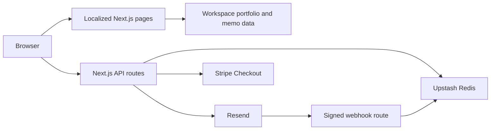

# Web Application Architecture

Use this guide for code conventions, application and data boundaries, portfolio updates, testing and releases. [Design System](DESIGN_SYSTEM.md) covers visual and editorial rules. [Integrations](INTEGRATIONS.md) covers provider setup, credentials and recovery.

## Navigation

- [Application boundaries](#application-boundaries), [code conventions](#code-and-components) and [presentation loading](#presentation-and-style-loading): ownership, routing, rendering and style delivery.
- [Portfolio data](#portfolio-data): source policy, financial measurement boundary, reconciliation and monthly updates.
- [Test workflow](#test-workflow), [release workflow](#release-workflow) and [production gate](#production-gate): verification and publication.
- [Review evidence](#review-evidence): local and CI evidence retention.

## Application boundaries

Pages render localized Server Components. Add small Client Components for interactive controls. Provider and preference-token modules declare `server-only`; shared support IDs, legacy amounts and types live in `src/features/support/support-config.ts`.

Node tests and the operator CLI use `scripts/register-server.mjs` to load TypeScript and TSX. The loader bypasses `server-only` for these entry points and does not type-check. TypeScript and Next.js separately enforce types and build boundaries.

Dependencies flow from app composition to features to shared modules:

| Layer                          | Responsibility                                                                                                |
| ------------------------------ | ------------------------------------------------------------------------------------------------------------- |
| `src/app/_components`          | Compose page chrome and feature content, including Home's portfolio and memo sections.                        |
| `src/features`                 | Own portfolio, memos, subscriptions, contact and support: data, types, controls, styles and server workflows. |
| `src/components` and `src/lib` | Provide shared UI, utilities and service clients.                                                             |

Features cannot import other features or `app`; shared modules cannot import either layer.

Email templates and fictional previews stay in their owning features and share `src/components/email-layout.tsx`. Preview modules import templates without service modules. Server delivery paths render production emails; retries keep the stored HTML and plain text. See [email templates](INTEGRATIONS.md#email-templates-and-local-preview).

ESLint checks static and dynamic import boundaries and runtime cycles, including `@/` aliases. Type-only cycles are excluded. Features and shared modules use literal dynamic-import paths; app composition can lazy-load features. Use direct imports; avoid barrels that mix server and client code.

App composition supplies the Footer subscription slot and injects the welcome memo provider into subscription orchestration. The provider runs only after the contact is confirmed not to be subscribed.

Feature API functions in `contact-api.ts` and `subscription-api.ts` define endpoints and input types. Shared `postJson` handles request deadlines, HTTP errors and idempotency headers. Success does not assert an unvalidated JSON type. Confirmation uses the same typed API for its token-only POST.

Routes validate untrusted HTTP input and map service results to responses. Subscription workflows live in:

- `server/request-preference-link.ts`: recipient limits, immutable retry payloads, contact lookup, rendering and delivery. Missing contacts receive the same public success response as existing contacts.
- `server/update-subscription-preferences.ts`: locks, journals, language synchronization, rollback and unsubscribe.

### Rendering and error boundaries

- Each page has one focusable main landmark; navigation and Footer sit outside it.
- Experimental `global-not-found` renders a complete localized 404 document with recovery links, without JavaScript. The request proxy derives `x-site-locale` from the path; normal pages keep static locale layouts.
- Memo routes use `generateStaticParams` and `dynamicParams = false` to reject unknown slugs.
- Payment verification and saved preferences stream under local Suspense boundaries. Ordinary Support visits and retry states render the native form before streaming. Header and Hero do not wait for providers.
- Localized error boundaries offer retry and Home actions; global errors use a minimal document. Never display raw errors or provider data.
- Each performance chart has `ChartBoundary`: Suspense contains streaming SSR errors; a client boundary offers localized retry and reports the original error to Sentry. Filtering replaces chart messages and nested causes, retains types and stack locations, and removes payloads and URL queries.
- Chart clients receive monthly observations only. Ledgers and return reconstruction stay server-side. Chart boundaries preserve sibling charts, navigation and methodology; they do not cover module initialization or shared page-data preparation.

### Routing and metadata

Language links preserve only server-validated parameters:

| Page         | Allowed state                                                                               |
| ------------ | ------------------------------------------------------------------------------------------- |
| Preferences  | Valid preference token                                                                      |
| Confirmation | Token with the expected opaque format; verify it on POST                                    |
| Support      | Recognized status, validated Session ID, or signed product/attempt/original-locale recovery |

Support validates signatures and the 23-hour expiry. Invalid or expired attempts retain only the retirement notice. Query parameters never prove payment.

Article metadata and safely serialized Article JSON-LD come from the localized memo catalog. Do not invent modification dates.

The locale Proxy excludes API, Next.js and Vercel paths, known public images and metadata resources. Unknown paths containing dots still receive localized 404 handling. Keep exclusions aligned with assets and metadata routes.

Pages compose Header and Footer. Home owns its header background; private service pages supply validated language-link parameters without making static locale layouts request-dependent.

### Content Security Policy

`next.config.ts` applies an origin-based CSP:

- Allow scripts from the site, Vercel Analytics and the Vercel toolbar. Block inline HTML event handlers and object embedding.
- Allow same-origin and blob workers for Sentry Replay.
- Allow inline scripts for static App Router hydration and Article JSON-LD. This is not a strict nonce policy.
- Allow `unsafe-eval` only in development.
- Enable `upgrade-insecure-requests` only in Vercel Production builds; local production and Preview retain HTTP localhost access.

Other connection and style behavior remains unchanged. A strict nonce policy would require dynamic rendering; assess caching costs first. See [Next.js CSP](https://nextjs.org/docs/app/guides/content-security-policy).



Pages read versioned portfolio and memo data from the workspace. Reader services use Resend, Redis and Stripe; their failure and recovery contracts are in [Integrations](INTEGRATIONS.md). Redis is not the research data source.

## Code and components

Names, types and structure should make behavior easy to follow.

- Use names that express domain meaning and responsibility rather than vague abbreviations. Give functions and components clear responsibility boundaries.
- Use types to express valid states, and still validate external data at boundaries. Make side effects, errors, and asynchronous outcomes easy to trace.
- Share implementations when responsibilities and behavior match. Preserve justified language, form, and service variants.
- Use comments to explain reasons, constraints, and tradeoffs rather than restating the code. Let Next.js and React rules enforce framework requirements.

See [application boundaries](#application-boundaries) for module ownership and [Integrations](INTEGRATIONS.md) for service procedures.

### Project standards

These conventions adapt [Bulletproof React's Project Standards](https://github.com/alan2207/bulletproof-react/blob/master/docs/project-standards.md) to this Next.js application.

- Use kebab-case for application files and folders; exported React components use PascalCase. Preserve Next.js routing and metadata conventions, including `(en)`, `[slug]`, `[...unmatched]`, `_components`, and `page.tsx`. Keep established tool configuration names and document titles.
- Use the single `@/*` alias from [`tsconfig.json`](../tsconfig.json) for imports across source directories. Relative imports are appropriate for adjacent files and root tooling. Node tests use the same alias through the explicit [loader](../scripts/register-server.mjs), retaining file extensions for `.mjs` helpers. Do not introduce barrel exports solely to shorten paths.
- Use UTF-8, LF line endings, two-space indentation, and a final newline. [EditorConfig](../.editorconfig) applies editor defaults; [Git attributes](../.gitattributes) normalize text line endings without treating binary assets as text. Prettier remains the formatting authority; Markdown trailing spaces may express intentional line breaks.
- Keep ESLint's flat configuration and type-aware rules. Lint commands reject warnings, and unused ESLint disable directives are errors. Scope necessary suppressions to the smallest affected code and explain their reason; remove them when the underlying exception disappears.
- Validate external data at runtime even when its TypeScript type is declared. During refactoring, update types and callers together, then run affected checks. Tests stay beside their owning code; shared test utilities live in `scripts/` and are never imported by application entry points.
- CI is the required verification gate for releases. Husky provides local pre-commit checks of staged files; see [README verification](../README.md#verification) for their scope and recovery steps. Hooks cannot replace CI and must not run complete browser suites on every commit. Choose focused local checks using [AGENTS](../AGENTS.md#verification-and-review).

### Lint and editor conventions

Test and style suffixes such as `.integration.test.tsx` and `.styles.ts` are allowed. App Router naming additionally permits dynamic/catch-all segments, route groups, parallel slots, private folders, interception prefixes and `.well-known`.

Vitest recommended rules apply only to `src/**/*.test.{ts,tsx}`. Testing Library and jest-dom rules additionally apply to component tests (`*.test.tsx`); custom-render inference is disabled so React SSR's `renderToString` is not treated as a Testing Library render. Playwright's recommended error-level rules apply only to `src/**/*.spec.ts`; advisory rules about conditional assertions and skips are not enabled because browser coverage uses viewport and platform matrices. Node `*.test.mjs` files retain the general JavaScript rules.

Keep Prettier last in the ESLint configuration. It owns formatting; import ordering is not enforced. VS Code settings enable format-on-save and explicit ESLint fixes; `.editorconfig` supplies other editor defaults. Verify lint scoping, naming exceptions and cycle detection with `node --test eslint.config.test.mjs`.

`prettier-plugin-tailwindcss` uses `src/app/globals.css` as its Tailwind v4 entry point. It sorts recognized `className` values and calls to `cn`, `clsx` and `cva`; plain strings in private style maps are not automatically recognized. Preserve cascade order, variant meaning and interpolation boundaries.

`npm run lint` runs ESLint. `npm run format:check` runs Prettier, including CSS parsing and Tailwind ordering. `eslint-config-prettier` disables conflicting rules. There is no CSS semantic linter; builds, browser checks and review must catch invalid properties and selector behavior. Hooks check files without rewriting them. Format, review and stage fixes before committing.

## Presentation and style loading

The root layout imports `src/app/globals.css` once. PostCSS compiles Tailwind themes and utilities. Tokens feed both Tailwind and CSS Modules; `base` provides the only reset and document defaults. Preflight and component-specific global selectors are not used.

Pages compose Server Components such as `Container`, `PageHero`, button links and feature content. Native primitives in `src/components/ui` keep forms server-compatible. Interactive DropdownMenu and Sheet use `radix-ui`; only interactive components and their owners declare `use client`.

Private `*.styles.ts` maps contain complete utility strings. Components import their own CSS Modules for chart structure and complex motion. `components.json` configures source installation. Email styling remains separate. [Design System](DESIGN_SYSTEM.md#style-ownership) defines variants and visual ownership.

`site-header-desktop.tsx` owns desktop navigation and language-menu state. `use-site-header.ts` owns mobile phases and measured panel/icon animations. `use-menu-touch-feedback.ts` owns the trigger/close touch ring.

The mobile phase drives Sheet's open state; Radix owns modal isolation, focus containment and scroll locking. Native disclosures work without JavaScript. See [interaction contracts](DESIGN_SYSTEM.md#interaction-motion-and-accessibility) for focus, interruption and input feedback.

Before a presentation migration, capture screenshots and computed styles. Compare in the same browser and viewport. Verify direct loads, client navigation and browser return against a production build; hot reload does not prove production style ordering. Measure assets before claiming a performance improvement. Test behavior independently of utility strings; physical iPhone checks remain separate.

## Portfolio data

The portfolio feature owns financial data, sources, calculations and monthly acceptance. Amounts and retrieval records below are dated evidence, not live quotes. Code records remain authoritative.

### Workspace data

`src/features/portfolio/portfolio-detail.ts` records 91 purchase lots with fees, SPY adjusted prices by applied trading date, 124 cash events, three corporate actions and 22 month-end position, price and XIRR snapshots.

- Amounts and prices use USD; dates use `YYYY-MM-DD`.
- Dividends are positive; withholding tax and financing interest are negative.
- Purchase cost is `grossAmount + fees`.
- Hypothetical SPY units are `grossAmount / adjustedClose`; simulated cash outflows include the full purchase cost.

`src/features/portfolio/portfolio.ts` derives holdings, cost basis, income, value and return history. It exports monthly simulated SPY results as `portfolioSpyMonthlyReturns` and the latest comparison as `portfolioSpySnapshot`. Home, Portfolio and Performance share this module. No database or separate processing service is required.

The latest month-end valuation defines `asOf`. Exclude later purchases and cash events from the snapshot. Include a simulated SPY purchase only after both its transaction and applied price dates. Preparing future records must not change the published snapshot.

The 2026-09-30 snapshot has 18 holdings and 22 monthly observations: USD 127,533.11 in stocks and ETFs and USD 121,237.01 in simulated SPY.

XIRR and TWR use the same boundary:

- Include listed stocks and ETFs in the ledger, including VGT and GRNY.
- Exclude cash, separate brokerage fund-account positions and liability balances. Still include financing interest as an expense.
- Include net dividends, withholding tax and trading fees. Account deposits, withdrawals and currency exchanges fall outside this boundary.

Performance shows reconstructed cumulative TWR versus SPY total return and since-inception annualized XIRR versus simulated SPY XIRR. Each chart has a monthly table. Omit XIRR horizons below 30 days. XIRR observations are not individual monthly returns.

The September update was reviewed against the monthly brokerage statement on 2026-10-05:

| Item                                                         | Reviewed result                  |
| ------------------------------------------------------------ | -------------------------------- |
| Position quantities                                          | Unchanged                        |
| Dividend and withholding-tax events                          | 16 events; USD 117.79 net income |
| Purchases, sales, deposits, withdrawals and interest charges | None listed for September        |
| Cumulative net dividends                                     | USD 644.48                       |
| Cumulative financing interest                                | USD 85.75                        |
| Since-inception annualized portfolio XIRR                    | 24.426811448224484%              |

XIRR was calculated independently from dated purchase costs, signed cash events and terminal stock value.

SPY's September inputs came from [Yahoo Finance](https://finance.yahoo.com/quote/SPY/history/) through its public chart endpoint on 2026-10-13. The same-vintage adjusted closes were USD 765.1499633789062 on 2026-08-31 and USD 762.6300048828125 on 2026-09-30.

To extend the frozen August basis, chain their ratio:

```text
766.95 × 762.6300048828125 / 765.1499633789062 = 764.4241132312882
```

The result is a rebased calculation price, not September's quoted close. Simulated units remain 158.5991478936601; value is USD 121,237.01298784906 and annualized XIRR is 19.264638392858824%.

Future extensions must use same-vintage adjusted-price ratios. Do not combine a newly adjusted endpoint with unchanged purchase prices without rebasing. This correction replaced rounded Stock Analysis inputs and increased September benchmark XIRR by about 0.00000494 percentage point. August and earlier observations, and displayed September value/XIRR (USD 121,237.01 and 19.26%), are unchanged.

### Historical price sources

Use Yahoo Finance only for new or replacement historical stock and ETF prices, including SPY. Record ticker, source URL, retrieval date, applied trading date, currency and adjustment basis. Mark missing observations unverified; do not substitute another provider.

Verify field definitions before use. Holdings need the share basis described below without dividend adjustment because dividends are recorded separately. SPY total-return comparisons need dividend-adjusted prices from one data vintage. Never substitute unadjusted closes or mix vintages without reconciling adjustments.

Apply this policy to additions and explicit corrections. Preserve existing provenance: replacing a non-Yahoo input requires new Yahoo evidence, not a new label. Reconcile published corrections and run the acceptance checks below.

### Calculation and updates

Keep source precision until display formatting.

- Portfolio cumulative return includes net dividends and deducts financing interest.
- Holding returns compare value with cost basis; they do not allocate portfolio-level interest.
- Dated events support cash-flow calculations; monthly quantities and prices support valuation.
- SPY units and values are derived. XIRR observations are stored results, not recalculated on requests.

Each month records the applied U.S. trading date, which precedes the calendar month-end when markets are closed. SPY is the only benchmark. Preserve previously published monthly prices and XIRRs unless the source evidence supports an explicit correction.

### Reconstructed time-weighted return

`portfolio-closing-marks.ts` contains 450 daily/event-date marks and 6,752 held-position prices for 2024-12-30 through 2026-09-30. Yahoo Finance chart data was retrieved on 2026-10-05.

- Use split-adjusted **close**, not dividend-adjusted close; the cash ledger records dividends and tax separately.
- Multiply VGT prices before its 2026-04-21 split by eight to match contemporaneous share counts.
- Use the preceding U.S. trading close for non-trading dates, retaining the applied date.
- Reconcile all 22 month-end stock valuations within USD 0.011.

Keep broker files and account identifiers outside the repository.

`portfolio-twr-calculations.ts` reconstructs returns for stocks and ETFs, not the whole brokerage account:

- Treat purchase gross amount plus fees as a beginning-of-period contribution.
- Value gifted securities at the preceding close as contributions, not gains.
- Treat splits as quantity changes only.
- Include net dividends, tax and financing costs at period end before removing them from the measured portfolio.
- Exclude cash, separate brokerage funds and liability balances, as for XIRR. Account deposits and withdrawals are outside the boundary; stock purchases and in-kind transfers enter it as contributions.

For each period:

```text
factor = (ending stock value + signed net income)
       / (preceding stock value + contributions)
```

Geometrically link factors for cumulative TWR. Monthly returns compare successive cumulative factors; the first month includes initial investment and fees.

Stop on missing event/position prices, unvalued transfers or invalid ordering. These are closing-price reconstructions with explicit flow timing, not observed intraday valuations. Keep weekend trade dates as recorded and apply the preceding close.

Server-only `portfolio-twr.ts` exports period valuations, monthly returns and the latest summary. Never bundle the historical price table into client code.

For September 2026, cumulative portfolio TWR is 38.2694002516289%, the linked monthly return is 5.2341595775561744%, and SPY cumulative total return is 32.19753204498825%. SPY uses one dividend-adjusted vintage from the first purchase date without simulated purchase fees. This index comparison differs from the same-investment-date XIRR simulation. Published XIRRs and their frozen price basis remain unchanged.

| Location                          | Return shown                                                                                                   |
| --------------------------------- | -------------------------------------------------------------------------------------------------------------- |
| Home and Performance summaries    | Reconstructed cumulative portfolio TWRR, not annualized                                                        |
| Portfolio summary and table Total | Cost-basis total return: 32.84% for September 2026                                                             |
| Individual holdings               | Position-level cost-basis return                                                                               |
| Performance charts                | Full cumulative TWR and annualized XIRR comparisons, each with a monthly table; no second set of summary cards |

Portfolio's “Total Return” and “Absolute Return” describe a percentage, not dollar profit or TWRR. Only the overall summary/table return includes net dividends and financing interest. Both TWR comparison series are cumulative and not annualized. Methodology copy in all three languages explains valuation and flow assumptions.

[GIPS methodology](https://www.gipsstandards.org/standards/gips-standards-for-firms/gips-standards-handbook-for-firms/) describes linked sub-period returns and flow conventions. The site claims neither GIPS compliance nor observed intraday TWR. The stocks-and-ETFs boundary matches XIRR; it is not a GIPS composite carve-out. Provision 3.A.15 requires cash and related income in composite carve-outs. Exact flow-time TWR requires actual valuations and event ordering at every external flow.

Refresh closing marks through the new month. Record source and retrieval date, verify split basis and reconcile every monthly position value. Refresh the entire SPY TWR vintage consistently; preserve the separately maintained XIRR history.

```sh
node --import ./scripts/register-server.mjs --test src/features/portfolio/portfolio-twr.test.mjs src/features/portfolio/portfolio-twr-calculations.test.mjs
```

Tests cover linking, contributions, fees, dividends, tax, interest, transfers, splits, non-trading dates, missing inputs and month-end reconciliation.

### Update and acceptance procedure

1. **Identify the revision.** Record snapshot month, provider/dataset, available version or retrieval date, adjustment basis and evidence-review date. Use a non-private batch label when no public version exists. Git identifies the published revision. Keep statements, account IDs, raw files and private paths out of Git and release notes.
2. **Update records.** Edit `src/features/portfolio/portfolio-detail.ts` for purchases, cash events, corporate actions, SPY prices and monthly valuations. Retain actual transaction dates and applied U.S. trading dates when they differ. Keep source precision. Change `src/features/portfolio/portfolio.ts` only for derivation or presentation changes.
3. **Reconcile before changing expectations.** Check purchase arithmetic (`shares × unitPrice = grossAmount`), fees, signed income/interest, monthly quantities and values, applied SPY dates, simulated units/value and stored XIRRs. Tests independently recalculate SPY XIRR and check that the latest portfolio XIRR zeros dated-cash-flow NPV. Keep independent portfolio calculation evidence privately. Investigate every mismatch.
4. **Run the data regression:**

   ```sh
   node --import ./scripts/register-server.mjs --test src/features/portfolio/portfolio.test.mjs
   ```

   | Check                                  | Tolerance               |
   | -------------------------------------- | ----------------------- |
   | Purchase arithmetic                    | USD 0.0001              |
   | Published cost and income totals       | USD 0.001               |
   | Monthly valuations and SPY values      | USD 0.011               |
   | Latest SPY snapshot                    | USD 0.01                |
   | Simulated SPY units                    | 0.000001                |
   | SPY XIRR                               | 0.0001 percentage point |
   | Dates, counts and stored XIRR pairings | Exact                   |

   Tolerances cover floating-point arithmetic, not conflicting prices, missing events or unexplained differences.

5. **Check affected pages.** For values or chart changes, run `npx playwright test src/features/portfolio/performance-chart.spec.ts src/app/_components/portfolio-form-status.spec.ts --project=chromium` and inspect all three locales. For KPI changes, run `npx playwright test src/app/_components/semantic-content.spec.ts --project=chromium --grep "financial summaries"`; [Design System](DESIGN_SYSTEM.md#css-layout-and-visual-language) defines visual rules.
6. **Accept and record.** Reconciliation, focused checks and affected pages must agree with the identified inputs. Document historical corrections and reasons. Before deployment, confirm release CI and identity under [AGENTS.md](../AGENTS.md#deployment-completion); do not routinely repeat the full suite locally.

Node.js, TypeScript and existing tests support data updates and calculations. Python and SQL are not required. Python may help with a one-time conversion or statistical task; it is not a runtime dependency or another data source.

## Verification responsibilities

| Layer                                            | Responsibility and configuration source                                                                           |
| ------------------------------------------------ | ----------------------------------------------------------------------------------------------------------------- |
| Prettier and Tailwind plugin                     | Formatting and recognized Tailwind class ordering; see the `prettier` field in [`package.json`](../package.json). |
| ESLint, typescript-eslint, and framework plugins | Code, type usage, and framework rules; see [`eslint.config.mjs`](../eslint.config.mjs).                           |
| TypeScript                                       | Type checking; see [`tsconfig.json`](../tsconfig.json).                                                           |
| Unit tests                                       | Logic, state, and failure handling.                                                                               |
| Playwright                                       | Layout, interaction, and browser behavior; see [`playwright.config.ts`](../playwright.config.ts).                 |
| Human review and device checks                   | Understandability, visual quality, and real-device experience.                                                    |

[README](../README.md#verification) lists commands. Configuration files define versions and CI behavior. Select affected checks using [AGENTS.md](../AGENTS.md#verification-and-review); use the [Design System](DESIGN_SYSTEM.md#design-verification) for visual acceptance and the [test workflow](#test-workflow) for isolation and CI evidence.

Change rules only for an identified problem, and check related tools, docs and tests for conflicts.

## Test workflow

Follow [Bulletproof React's testing guidance](https://github.com/alan2207/bulletproof-react/blob/master/docs/testing.md): test observable outcomes and service boundaries. Run real handlers and services with provider I/O mocked. Render real components through the shared loader. Check metadata, redirects, payloads and recovery state rather than implementation names. Reserve source assertions for boundaries such as `server-only` that runtime tests cannot establish. Preserve failure, interruption and retry coverage when consolidating cases.

### Runners and isolation

| Runner                  | Files and scope                                                                 |
| ----------------------- | ------------------------------------------------------------------------------- |
| Vitest unit             | Colocated `*.test.ts`                                                           |
| Testing Library and MSW | Colocated `*.test.tsx`, using jsdom                                             |
| Node                    | Existing colocated `*.test.mjs`, plus root configuration and `scripts/` checks  |
| Playwright              | Colocated `src/**/*.spec.ts`; Chromium runs all cases, WebKit selects `@mobile` |

`vitest.config.ts` separates unit and integration projects and resolves aliases. MSW intercepts provider HTTP, rejects unhandled requests and resets handlers after each test. `scripts/vitest-setup.ts` cleans up components and fails unexpected requests even if app code catches their errors. No MSW worker runs in production. Vitest excludes Node and Playwright files; application entry points never import tests.

The loader, shared helpers, WebKit runner and production gate live in `scripts/`. The journal CLI stays with subscriptions at `src/features/subscriptions/server/subscription-journal-cli.mjs`, invoked through `npm run subscription:journal`.

`npm test` runs Node and both Vitest projects; `verify:static` includes it. Playwright runs separately. After a build, run selected production cases with `PLAYWRIGHT_USE_PRODUCTION_BUILD=1 npm run test:e2e -- <spec-files> --project=chromium` or `webkit`.

WebKit uses the iPhone 13 viewport, touch, scale and user agent. Tag only phone-sized, mobile-compatible cases `@mobile`. Keep mouse-hover, CDP-only, desktop and cross-breakpoint cases in Chromium. Browser servers use isolated provider settings. Both engines test Contact's unavailable-service response; MSW and route tests cover success and retries. None proves live email delivery.

### Coverage contracts

- Contact integrations check localized normalization, delivery payloads, errors and retry identity through MSW.
- Memo checks resolve real Next.js redirects and verify localized HTTP 308 destinations and landmarks.
- Subscription checks verify welcome payloads, preference links and expiry at the deadline.
- Portfolio checks verify per-share cost and sorting. `portfolio-page-content.integration.test.tsx` covers all locales, table accessibility, controls, holdings and reconciled totals. Node checks retain the Server/Client boundary.
- `semantic-content.spec.ts` checks KPI semantics, colors, opacity and composited contrast using `scripts/color-contrast.ts`. Visual rules live in [Design System](DESIGN_SYSTEM.md#typography-roles).
- Header cases live in `components/site-header.spec.ts`; cross-page layout and CTA cases live in `app/_components/page-layout.spec.ts`. Feature journeys stay with their feature.

References: [Vitest projects](https://vitest.dev/guide/projects), [Testing Library setup](https://testing-library.com/docs/react-testing-library/setup/), [MSW Node integration](https://mswjs.io/guides/integrations/node).

### CI and evidence reuse

CI checks out the PR head SHA or exact push SHA. PRs always run full verification. The read-only `plan` job decides whether a main push may reuse complete PR evidence.

After `plan`, full verification runs five jobs concurrently:

| Jobs                                   | Runner and work                                                                                    |
| -------------------------------------- | -------------------------------------------------------------------------------------------------- |
| `static`                               | Ubuntu: locked install, production dependency audit, types, ESLint, Prettier and Node/Vitest tests |
| `chromium-shard-1`, `chromium-shard-2` | Ubuntu: production build and native Playwright shards with `--fully-parallel`                      |
| `webkit-shard-1`, `webkit-shard-2`     | macOS: production build and mobile WebKit shards                                                   |

Each browser job uses one worker. Fail-fast is disabled so one shard does not cancel another. Browser jobs do not wait for static checks; this can consume runner time after a static failure, but cannot authorize release. Stable `verify` and `webkit` result jobs reject failed, cancelled or unexpectedly skipped dependencies. There is no separate CSS lint job.

`scripts/ci-plan.mjs` permits reuse only when:

1. Main is a two-parent merge whose tree matches its second parent.
2. The latest matching same-repository PR CI run succeeded within 24 hours.
3. That run attempt passed all five jobs above; partial or previously reused evidence is insufficient.

Changed trees, workflows, lockfiles or test settings; stale evidence; squash/rebase merges; missing records; and API errors require full testing. The summary records the source run, tree and release SHA. Main still creates its own successful CI record for the production gate. Runner and runtime changes can occur outside Git, so reuse expires.

### Local runs and shard maintenance

Use affected checks locally. Full `npm run verify` and `npm run test:webkit` are for diagnosis or explicit requests. If Turbopack cannot bind a worker port locally, use `npm run build -- --webpack` and report it; CI retains Turbopack.

The WebKit runner accepts `--shard=1` or `--shard=2`; otherwise it runs two sequential processes. Positional spec paths narrow coverage. It rejects `--grep` and `-g`, which would replace the mobile filter. Inspect coverage with `npx playwright test --project=webkit --list`.

WebKit uses complementary file lists: shard 1 selects `scripts/webkit-shard-1.txt`, and shard 2 uses its inverse. Paths are relative to Playwright's `src` test directory. Both retain the project's `@mobile` filter, and newly discovered files automatically enter shard 2. The current balance uses JSON timing reports from [CI run 38081612414](https://github.com/Tianyi0510/modern-fundamental-analyst/actions/runs/38081612414): its test steps took approximately 285/195 seconds. Summing every recorded attempt, including retries, under the revised file allocation gives approximately 231.5/231.3 seconds of test work. These are planning estimates; they exclude inter-test overhead, new tests and subsequent test optimizations, and require confirmation in the next full CI run. Keep slow header and typography files in different groups. `scripts/browser-shards.test.mjs` verifies that both browsers' partitions cover every discovered test exactly once.

Each shard uploads per-test JSON timing reports for 14 days and separate failure/retry evidence for seven days. Compare test-step and total-job times: extra builds and installs can offset parallelism gains and increase usage. Rebalance the WebKit file list when workload changes.

### Reliable browser checks

- Reuse a test's isolated page for sequential full navigations. Navigation clears document-scoped styles; wait for fonts before geometry assertions.
- Compare direct, client and history navigation with a separate direct-load baseline. Avoid reloading while an earlier page is prefetching.
- Check CTA keyboard modality without Tab-induced scrolling. Confirm `:active`, observe the press duration, and release on the same control while preventing navigation or submission.
- Poll short animations at bounded intervals. Keep intermediate, interruption, locale and reduced-motion assertions. Parameterize Header cases by locale so retries repeat only the failing locale.
- Capture and pause short touch-release animations before sampling. Dispatch cancellation and sample its midpoint in one browser task; finish the captured effect before checking settled state.
- Keep production durations and CI retries unchanged. Do not add arbitrary sleeps or filter page errors.
- For copy changes, find old wording, translations and accessible names in tests and fixtures. Update affected checks without weakening behavior or meaning assertions.

## Release workflow

1. Push the reviewed PR and wait for full CI and the Vercel Preview for its head SHA.
2. When release is authorized, merge the verified PR into `main` and record the resulting SHA. GitHub automatically deletes the remote PR branch. Main CI verifies reusable evidence or runs the complete suite.
3. Confirm a Vercel production deployment exists for that SHA. Distinguish a missing Git trigger from a deployment waiting for CI, building, failed or ready. If no deployment appears, inspect the Git integration instead of rerunning successful tests. Create a deployment from that Git reference when integration recovery requires it.
4. Wait for successful release CI, Vercel `READY`, matching deployed SHA and production aliases. A ready preview or successful CI alone does not establish production success. Preserve the exact-commit gate; retry a timed-out deployment only after that same SHA has passed CI.
5. After production succeeds, fetch/prune refs, confirm no commits were added after merge, leave the merged branch and safely delete it with `git branch -d`. Remove only clean task-owned temporary worktrees when needed. Preserve ongoing work and unmerged commits; never force-delete to resolve uncertainty. Start subsequent work from current `main`.

A PR-only request does not authorize merging. Deployment includes safe local cleanup of the released branch. Production browser smoke tests are optional follow-up checks unless evidence indicates a failure. Report deployment completion promptly once version and live-state checks pass.

## Production gate

Vercel waits up to 30 minutes for the latest main push CI run matching `VERCEL_GIT_COMMIT_SHA`. Only `success` permits the build to proceed. Preview and local builds skip the gate.

The macOS job allows 20 minutes. The remaining wait covers ordinary queueing and leaves build time under Vercel's [45-minute limit](https://vercel.com/docs/limits#build-time-per-deployment). Longer queues can time out; redeploy the same SHA after CI passes.

- Poll once per minute. Retry network, body-read, JSON parse, malformed-response and server failures with backoff up to four minutes.
- Reset the failure count only after parsing and validating the full response. Honor `Retry-After` and quota-reset headers within the original deadline.
- Fail closed on missing metadata, non-retryable errors, cancellation or timeout.
- Public GitHub access needs no extra credential. Add scoped authentication before making the repository private.
- Preserve the gate in `vercel.json`'s build command. Keep it out of `npm run build`, since CI must not wait on itself.

## Review evidence

Keep local screenshots and dated notes in `../local/audit/`. Legacy `audit/` remains excluded by Git and Vercel. Archive inactive caches or builds under `../local/archives/`; tools recreate their normal output paths.

Keep `node_modules/`, local environment files and Vercel project linkage in the checkout. npm and Next.js/Turbopack require normal module resolution. Local evidence is historical, not a current issue list, and is absent from fresh clones. Keep durable decisions in tracked docs. Share reviewed evidence with relative image paths and its date, commit, environment and resolution status.

CI keeps failed-attempt screenshots and traces for failed attempts and all retries, including passing retries. Upload artifacts even when the job passes; retain them for seven days.

WebKit runs fresh processes in two isolated jobs because a long-lived worker previously stalled. Output goes to separate `node_modules/.cache/playwright/webkit-shard-1/` and `node_modules/.cache/playwright/webkit-shard-2/` directories. Local traces remain in `node_modules/.cache/playwright/`.

See [`playwright.config.ts`](../playwright.config.ts), [`ci.yml`](../.github/workflows/ci.yml) and [README](../README.md#verification). The [CI workflow](#ci-and-evidence-reuse) defines concurrent jobs and reuse requirements.

The split follows the [Next.js testing guide](https://nextjs.org/docs/app/guides/testing): Node's isolated test runner covers service logic, while Playwright checks rendered pages and interactions against a production build. Browser project, shard and retry-trace settings follow the [Playwright projects](https://playwright.dev/docs/test-projects), [sharding](https://playwright.dev/docs/test-sharding) and [trace viewer](https://playwright.dev/docs/trace-viewer) guides.

## Subscription consent boundary

Signup requests send confirmation links. Explicit confirmation activates consent under the shared lock and journal; welcome delivery is separate. Redis stores confirmations, consent, limits, suppression, completed webhook identities and recovery records. Resend owns contact delivery and provider suppression. See [subscription operations](INTEGRATIONS.md#subscription-confirmation-and-delivery-feedback). No additional provider or queue is used.

## Deterministic date rendering

`src/lib/format.ts` validates ISO calendar dates and formats UTC components with fixed English month names or Chinese numeric dates. Compact English months use three letters, including `Sep`. This avoids Node/WebKit ICU differences and hydration mismatches. Keep hydration warnings visible. The chart regression checks server output and browser errors after interaction in all locales.
